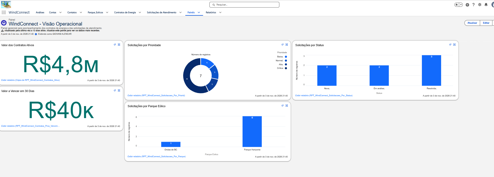

# Dashboard 01 — WindConnect | Visão Operacional

## 1. Objetivo

Dashboard gerencial desenvolvido no Salesforce para acompanhamento dos contratos de energia e das solicitações de atendimento.

## 2. Indicadores apresentados

- Valor dos Contratos Ativos.
- Valor a Vencer em 30 Dias.
- Solicitações por Prioridade.
- Solicitações por Status.
- Solicitações por Parque Eólico.

## 3. Resultado

Painel desenvolvido para facilitar o acompanhamento operacional e apoiar a tomada de decisões.

## 4. Evidência

